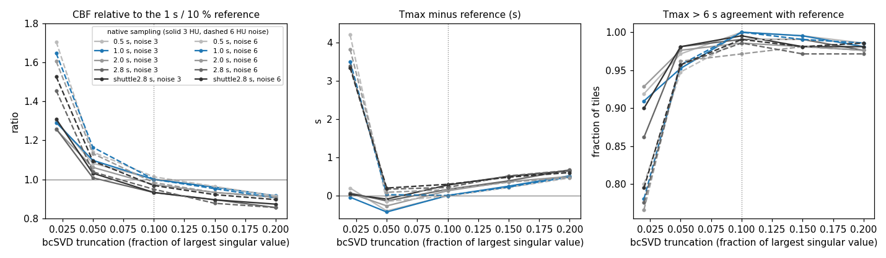
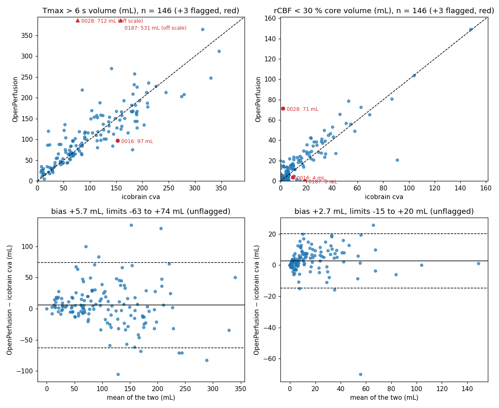

# OpenPerfusion — open-source CT perfusion for acute stroke

[](https://doi.org/10.5281/zenodo.23520559)
[](https://github.com/OpenPerfusion/OpenPerfusion/actions/workflows/ci.yml)

**Status: research prototype (v0.4.0). Research use only. Not a medical device. Not for clinical decision-making.**
The name is free on PyPI. "RAPID" is a registered trademark of iSchemaView; OpenPerfusion is validated against RAPID output but is not affiliated with it.

## What it does

4D CT perfusion (Hounsfield units, `(X, Y, Z, T)`) in; RAPID-style outputs out:

1. **Masking** — soft-tissue brain mask from the pre-contrast frames (HU window, opening, largest component per slice, hole fill, edge erosion).
2. **Concentration** — pre-bolus baseline chosen from the *arterial* arrival (brightest 0.5 % of voxels), subtracted per voxel; optional in-plane and temporal Gaussian smoothing.
3. **AIF / VOF** — automatic, after Straka, Albers & Bammer (JMRI 2010): per-voxel peak height, arrival (searched backwards from the peak, robust to noise), FWHM; cost `1.0·z(h) − 3.5·z(a) − 1.0·z(w)`; best spatially connected cluster, grown to the vessel footprint. Candidates must pass a single-bolus test and a noise-relative amplitude floor; a pick that peaks ≥ 8 s before the whole-brain tissue curve, or carries less than 1/2.5 of the venous area, is re-selected amplitude-first among brighter curves (the ISLES'24 traps, below). VOF = tall, late cluster; partial-volume correction `k_av = AUC_v / AUC_a`, skipped (and flagged) if the venous curve is truncated.
4. **Deconvolution** — three delay-insensitive (circular, zero-padded) engines:
   `bcsvd` (block-circulant SVD, fixed truncation; Wu 2003), `osvd` (per-voxel truncation by oscillation index; Wu 2003; default), `fourier` (Wiener-regularised frequency division, the RAPID formulation in Straka 2010).
5. **Maps** — CBF (mL/100 g/min), CBV (mL/100 g), MTT (s, central volume), Tmax (s, parabolic sub-sample peak), TTP.
6. **Thresholds** — vessel (CBV) and CSF (baseline HU) exclusion; rCBF relative to the contralateral, less-hypoperfused hemisphere; core = rCBF < 30 %; hypoperfusion = Tmax > 6 s; Tmax > 4/8/10 s volumes; HIR; cluster filter; mismatch volume and ratio; DEFUSE-3 target-profile flag.
7. **Validation harness** — digital phantom recovery (tile-wise errors, delay response) and reference-software comparison (voxel correlations, Dice of thresholded regions, volume bias / limits of agreement / ICC, DEFUSE-3 kappa), with figures.

## Install and run

```bash
git clone https://github.com/OpenPerfusion/OpenPerfusion.git && cd OpenPerfusion
pip install -e ".[dicom,register,node,dev]"   # pydicom + JPEG codecs, SimpleITK, pynetdicom + pillow, pytest + pyarrow
pytest tests                # phantom recovery, DICOM round trip, motion correction (~15 s)

openperfusion phantom --out results/phantom                 # digital phantom → CSV, JSON, PNG
openperfusion isles2018 /path/to/ISLES2018/TRAINING --figures --out results/isles2018
openperfusion dicom /path/to/ctp_dicom_dir --motion --out results/case   # vendor export → NIfTI maps + summary.json
openperfusion serve --out /data/openperfusion --motion --push-to orthanc:4242:ORTHANC   # shadow-mode DICOM node
```

Defaults are the configuration validated against RAPID on ISLES 2018: block-circulant SVD with 10 % truncation,
1.5 mm in-plane smoothing, contralateral-hemisphere rCBF reference, 1 mL cluster filter.

## Input

`openperfusion dicom` reads a directory of DICOM CT images (one series, one file per slice per time point, or an
enhanced multi-frame file), rescales to HU, assigns slices by position and frames by acquisition time, and resamples
each slice's time series to a uniform grid (default 1 s). Shuttle / jog-mode acquisitions, where alternating table
positions are sampled at offset, irregular times, are handled by that resampling and flagged in `summary.json`.
`--motion` applies per-frame in-plane rigid registration (phase-correlation translation on skull-edge maps, then a
coarse-to-fine rotation search on brain-windowed normalised cross-correlation) to the mean pre-contrast frame.
Both are tested by writing the digital phantom out as DICOM and reading it back, and by imposing known shifts and
rotations and recovering them (to < 0.6 voxel and < 1°). Motion parameters are estimated on a copy downsampled to
about 256 pixels across and applied at full resolution; the rotation search is skipped for frames whose
translation-only fit is already near-perfect, so a 512 × 512 × 16-slice × 50-frame export takes about 100 s.

### QC verdict

Every run ends with a verdict (`openperfusion.qc.qc_verdict`; `status` and `warnings` at the top of
`summary.json`): `ok`, `review` (maps produced, but a fallback arterial input was used, the arterial input peaks
8 s or more before the tissue, the acquisition was short, the head moved more than 5 mm / 5°, or frame timing had
to be assumed; a truncated or missing venous curve is
reported but does not change the verdict, since it only switches off the partial-volume correction), or
`reject` (no plausible arterial input: last-resort pick, peak below 15 HU, or an arterial curve that rises again
after the bolus, as in a jog-mode artefact). On ISLES'24 the `reject` rule is the difference between a Tmax > 6 s
ICC of 0.63 and 0.87 against icobrain cva on 149 subjects; a deployed system should refuse a `reject` study with its warning rather
than report through it. The same flags are recorded per case by the validation harness, so every dataset result
below is reported with and without the flagged cases.

### Shadow-mode DICOM node

`openperfusion serve` is a DICOM Storage SCP (pynetdicom) that accepts any storage SOP class in any transfer
syntax, files instances under `incoming/<study>/<series>/`, and processes a series once it has been quiet for
30 s and holds at least 60 images (anything smaller is a scout or a plain CT and goes to `skipped/` with the
reason). Processing is the same chain as `openperfusion dicom` (`--motion` optional) plus the QC verdict, and the
output is NIfTI maps, `summary.json`, and DICOM Secondary Capture series (`openperfusion/dicom_out.py`): CBF, CBV,
MTT and Tmax as colour maps, the core / Tmax > 6 s regions as an overlay, and a text panel with the volumes and the
QC warnings, all filed under the source StudyInstanceUID with series numbers 9001-9009 and "research" in every
series description. With `--push-to HOST:PORT:AET` the DICOM results are C-STOREd to a destination; `reject`
studies are not pushed. `deploy/docker-compose.yml` runs a research Orthanc beside the node: Orthanc receives a
copy of each CTP study (a second destination on the scanner, or a PACS forwarding rule), a Lua rule forwards CT
series with 60+ images to the node, and the node pushes its maps back so both can be read in Orthanc's viewer.
Nothing in that setup talks to the clinical PACS; that is what shadow mode means here.

Tested end to end: a phantom series C-STOREd to the node, processed, written as 5 × Z + 1 DICOM objects under
the source study and pushed to a second SCP (`tests/test_node.py`), and a real GE cine export (UniToBrain
MOL-005: 712 JPEG-lossless files) received in 9 s and processed with motion correction in 79 s. The compose file
itself has not been run here (no Docker daemon in the development environment); it is standard Orthanc
configuration and the first thing to check on a real deployment.

## Real vendor data: UniToBrain (GE LightSpeed VCT, 11 patients, two acquisition modes)

The first real exports the reader saw were eleven patients of [UniToBrain](https://ieee-dataport.org/open-access/unitobrain)
(258 stroke CTPs from a GE LightSpeed VCT, 80 kVp, raw DICOM, open access). `scripts/fetch_unitobrain.py` pulls
single patients out of the 80 GB archive by HTTP range requests (about 130 MB per patient); `scripts/unitobrain_batch.py`
runs every patient and compares with the dataset's own NLR maps; per-patient results are in `results/unitobrain/`.
They turned out to be two different protocols, and between them they found five real bugs, all fixed and all now defaults:

| what the data looked like | what broke | fix |
|---|---|---|
| 512 × 512 at 0.49 mm, 80 kVp (noise 5–8 HU per voxel) | a 50 HU curve crosses 20 % of its peak inside the noise, so weak voxels looked like the earliest arrivals and the AIF selector chose a 44 HU cluster over basal arteries at 500 HU | per-voxel arrival threshold ≥ 4 SD of the curve's own pre-bolus noise; candidate clusters scored on their bright core; AIF must peak ≥ 2 s before the whole-brain tissue curve |
| 0.5 s cine frames, slow boluses | noise bumps with peaks of 20–30 HU entered the candidate pool and won on "arrival" | candidate peak must be ≥ 6 × its own noise SD |
| ICA next to the cavernous sinus at 0.49 mm | the 6-voxel arterial seed grew into 12 voxels peaking 4 s later | cluster growth restricted to voxels peaking within 2 s of the seed |
| GE cine mode: AcquisitionTime identical for all 89 frames; frame time only in private (0019,1024) Mid Scan Time | all frames collapsed onto one time point | the reader chooses the timing source per series (GE mid-scan time, AcquisitionTime, TriggerTime, ContentTime, else InstanceNumber order) and records it in `meta["time_source"]` |
| 0.49 mm voxels vs ISLES's 0.8–1.0 mm | smoothing and mask erosion were in voxels, so vendor exports got half the physical smoothing and the Tmax maps were patchy | `spatial_sigma_mm`, `mask_open_mm`, `mask_erode_mm` (1.5 / 2 / 1 mm, the smoothing re-selected by split-half), converted per dataset |

Patient MOL-001 is a two-position shuttle acquisition (16 slices × 5 mm sampled alternately every 2.8 s); the other
ten are cine mode (8 slices, 89 frames at 0.5 s, 44 s). All eleven now load unaided, get an arterial input function
(peaks 100–340 HU) and produce maps a clinician would recognise: left MCA-territory Tmax lesions in MOL-001, -007 and
-012 and a right-sided one in MOL-011, each on the same side as the dataset's own delay map; a clean negative in
MOL-005; one patient (MOL-006) who moved 6.4 mm and 6.5°, the first real test of the motion correction, which
registered the frames in 66 s and still produced a lateralised map. Whole-brain median MTT is 6–9 s on the cine
cases. Correlation with the NLR reference maps is 0.6 for CBF and 0.6–0.8 for CBV on the ten cine cases (the
reference maps are from a different, registered and filtered reconstruction, so voxelwise agreement is bounded);
their absolute CBF is about half of ours and their delay map is not the same quantity as Tmax, so only sidedness
and relative patterns are compared. On ISLES 2018 the same changes were a net gain (tables below), so none of them
is a special case for one scanner.

One caveat these cases made concrete, now quantified on the phantom (`scripts/phantom_sampling.py`,
`results/phantom_sampling/`): absolute CBF and MTT depend on the SVD truncation (on MOL-001, whole-brain median CBF
13, 20 and 32 mL/100 g/min at 10 %, 5 % and 2 % truncation), and the 10 % default was calibrated against RAPID on
1 s ISLES data. The phantom, acquired at 0.5, 1, 2 and 2.8 s and in two-position shuttle mode and resampled to the
reader's 1 s grid exactly as vendor exports are, says the sampling itself is a small effect: with the 10 % default,
CBF reads 1.00 / 0.97 / 0.93 / 0.93 of the 1 s value at 0.5 / 2 / 2.8 / shuttle sampling and Tmax shifts by at most
+0.3 s, with 99 % agreement at the 6 s boundary; 10 % remains the best truncation at every sampling, and oSVD is
equally stable. The large swing on MOL-001 is the truncation choice itself (CBF x1.29 / x1.10 / x1.00 at 2 / 5 / 10 %
on the phantom at any sampling, and x1.65 at 2 % once noise doubles), not the resampling. So: keep 10 %; expect
absolute CBF to read about 5-7 % low on shuttle data; relative core is unaffected. Whether RAPID's own numbers shift
with sampling is a question for the paired cohort.



## ISLES'24: Siemens and Philips scanners, icobrain cva as the reference (all 149 subjects)

[ISLES'24](https://pubs.rsna.org/doi/10.1148/ryai.250603) has 149 training subjects from two centres on Siemens
(Somatom Force, Xcite, AS+) and Philips (Brilliance 64, Ingenuity) scanners, with the 4D CTP (co-registered,
1 s frames, mostly 1 x 1 x 5 mm) and CBF/CBV/MTT/Tmax maps from icobrain cva, a second FDA-cleared package, plus the
follow-up DWI lesion. `scripts/fetch_isles24.py` pulls the parquet shards (one subject each, ~200 MB) from the
Hugging Face mirror, resumably; `openperfusion/io_isles2024.py` loads a subject straight from its shard in the same
shape as the ISLES 2018 loader, so the same harness runs (`scripts/run_isles2024.py --parquet`).

The maps live on the NCCT grid and the CTP on its own, and for some subjects the header alignment between the two
is off by millimetres to centimetres (sub-stroke0010: 37 mm; two subjects' headers put the volumes so far apart
that they do not overlap and the registration starts from the volume centres instead), so the loader refines it
with a rigid registration of the CTP pre-contrast mean to the NCCT (`openperfusion/register.py`, SimpleITK, mutual
information) and keeps the registered alignment when it improves the brain-window correlation (112 of 149).

Every run is reported two ways: all subjects, and excluding those the pipeline itself marks `reject`
(`aif_fallback` or `aif_last_resort`: the primary arterial search failed and a weaker fallback was used). The
harness rows carry the flags; `scripts/isles2024_summary.py` writes both summaries.

| metric, 149 subjects, defaults as validated on ISLES 2018 (no tuning) | all 149 | excluding the 3 flagged |
|---|---|---|
| Tmax > 6 s volume | ICC 0.63, bias +12 mL, LoA -123 to +147 mL | ICC 0.87, bias +6 mL, LoA -63 to +74 mL |
| Tmax > 6 s Dice, mean (median) | 0.68 (0.73) | 0.68 (0.73) |
| rCBF < 30 % core volume | ICC 0.88, bias +3 mL, LoA -18 to +24 mL, Dice 0.42 | ICC 0.91, bias +3 mL, LoA -15 to +20 mL, Dice 0.43 |
| voxelwise r, CBF / CBV / Tmax | 0.81 / 0.77 / 0.65 | 0.81 / 0.78 / 0.66 |
| DEFUSE-3 target-profile agreement | 0.93 | 0.94 |
| best-matching Tmax threshold for icobrain's > 6 s boundary | 6 s (Dice 0.68; 5 s 0.63, 7 s 0.65) | 6 s (Dice 0.68; 5 s 0.63, 7 s 0.66) |
| hypoperfusion vs follow-up infarct, Dice | ours 0.16, icobrain 0.17 | ours 0.16, icobrain 0.17 |



The three flagged subjects: sub-stroke0028 (8 x 10 mm slices) carries a periodic artefact through the whole slab,
every curve rising every ~15 s, like a jog-mode acquisition resampled with imperfect registration; no curve passes
the single-bolus test and the result is 712 mL of Tmax > 6 against icobrain's 77. sub-stroke0187 is a split bolus
(two arterial peaks 10 s apart, the tissue curve with two shoulders); the pipeline's pick leads the tissue peak by
15 s and it goes to the fallback (531 vs 158 mL). sub-stroke0016's primary search failed its plausibility checks
and a 41 HU fallback was used; its volumes agree anyway (97 vs 153 mL), but the flag is about the evidence. Three
cases are the difference between the two columns for Tmax > 6, which is the argument for honouring the QC flags: a
deployed system refuses them with the warning rather than reporting through them. Per-subject results with flags:
`results/isles24_149/cases.csv`.

### What the second 99 subjects taught the arterial selector

The first 50 subjects agreed with icobrain at ICC 0.89; the next 99 brought the all-subject ICC down to 0.36
(`results/isles24_149_first_selector/`), and the cause was seven slab-wide over-calls, not noise. Taking them apart
(`scripts/isles2024_inspect.py`, `results/inspect/`) showed one mechanism in five of them: the arterial selector,
whose cost weights arrival three and a half times as heavily as amplitude (the right choice on ISLES 2018's thin
slabs), chose an early, dimmer population over the cerebral arteries once the slab reached the skull base:
sub-stroke0163 a 1,000-voxel 70 HU cluster peaking 8 s before the tissue, beside 300 HU arteries peaking 2 s before
it (830 mL of Tmax > 6 against icobrain's 8); sub-stroke0086 and 0188 a 150 HU skull-base vessel 8 s ahead of the
tissue beside 200-260 HU arteries 2-4 s ahead; sub-stroke0113 a narrow 156 HU spike in a slow, dispersed bolus whose
real arteries were 25 s wide and excluded by a fixed 15 s width bound. In every one the normal-tissue Tmax read
6-8 s instead of 2 s, because every Tmax is measured from the arterial input.

One number separated all seven from the other 142: the lead of the arterial peak over the whole-brain tissue peak,
8-15 s in the seven and 1-7 s in the rest (median 3 s; the same distribution on ISLES 2018, where one case has a
lead of 13 s). Three targeted rules follow (`openperfusion/aif.py`, all on by default):

* lead rule: when the pick peaks >= 8 s before the tissue, the selection is repeated among brighter curves whose
  lead is below 8 s, amplitude first, and the later pick replaces the first when it is at least 80 % as bright
  (`aif_max_lead`);
* vein rule: when the venous curve has more than 2.5 x the arterial area (the partial-volume factor the pipeline
  already refused to apply), the selection is repeated among curves with at least vein / 2.5 of enhancement;
* width rule: the arterial width bound follows the bolus (0.9 x the whole-brain curve's FWHM when that exceeds 15 s).

Four of the five are fixed (0086: 154 vs 108 mL; 0113: 183 vs 180; 0163: 11 vs 8; 0188: 122 vs 51), and the QC
verdict now marks any remaining lead >= 8 s for review, which is where the split bolus lands. Re-weighting the
cost itself was tried first and rejected: it fixes the same cases but costs 1-2 Dice points and up to 6 kappa
points against RAPID (`results/variants/README.md`); the targeted rules leave ISLES 2018 unchanged or better
(Tmax > 6 ICC 0.953 -> 0.955, Dice 0.846 -> 0.844, core ICC 0.982 -> 0.984, DEFUSE-3 kappa 0.777 -> 0.881) and
change the Tmax > 6 volume by more than 10 mL in 12 of the 149 ISLES'24 subjects. The audit of the 6 s boundary on
every subject (`scripts/tmax_tail_audit.py`, `results/audit/`) stands: against RAPID our normal-tissue Tmax tail
matches (99th percentile 6.1 vs 6.0 s); icobrain's is clipped by smoothing (5.7 vs our 8.2 s) and it calls more
hypoperfusion than we do in most subjects, so voxel overlap against it (Dice 0.68) is lower than against RAPID
(0.85) for reasons that are not ours to fix. An enhancement-SNR gate (`PipelineConfig.snr_min_tissue`, off) was
tried for that and rejected on ISLES 2018.

### One subject's reference maps are not on their own grid

sub-stroke0026 agrees with icobrain at voxelwise r = 0.04 for CBF, CBV and Tmax alike, although the CTP registers
to its NCCT cleanly (skull edges coincide, both initialisations converge to the same transform). The fault is in
the reference: in native NCCT space icobrain's maps are displaced from the NCCT by about 19 mm in-plane, their
outline is a tilted box that misses a third of the brain, and the map reads a lower CBF in grey matter than in
white matter (`results/inspect/sub-stroke0026/reference_alignment.png`). `scripts/isles2024_refcheck.py` scores
this for every subject from the NCCT and the icobrain CBF alone (slice-wise Dice and centroid offset between the
map and the NCCT brain mask over the slab the map covers, a few seconds per shard, `results/isles24_149/refcheck.csv`):
aligned subjects sit at Dice 0.90-0.94 and 1-5 mm, sub-stroke0026 at 0.70 and 18.7 mm, nothing else below
0.79 or above 9.4 mm. `scripts/isles2024_summary.py` reports a fourth stratum without it (n = 145: Tmax > 6
ICC 0.87, bias +6 mL, LoA -62/+74, Dice 0.69; core ICC 0.91), which differs from the n = 146 figures only in the
second decimal; the point is that a reference's own alignment is something to check before a voxelwise comparison,
and that the pipeline's own flags are not the only reason to set a subject aside. The other low-correlation
subjects (sub-stroke0079 r = 0.19, 0010 and 0037 at 0.34, 0040 at 0.40) pass the check; 0040 is a 16-slice, 10 mm
acquisition against 0.8 mm NCCT slices, and the rest are still to be looked at.

## Digital phantom

`openperfusion.phantom.make_phantom()` builds a Kudo-style phantom: a 7 × 7 grid of tiles spanning CBF 10–70 mL/100 g/min × MTT 4–16 s, one slice per tracer delay (0–3 s), exponential or box residue functions, an arterial block (partial-volumed to 70 %), a venous block (delayed, dispersed, same area), normal reference tissue (CBF 50 / MTT 4), a CSF block, skull and air. Curves are generated on a 0.05 s grid and sampled at 1 s, so the estimator sees realistic discretisation error. Noise is Gaussian in HU.

Current recovery (oSVD, 3 HU noise, `openperfusion phantom`):

| quantity | result |
|---|---|
| AIF / VOF voxels found inside the true vessels | 100 % / 100 % |
| partial-volume factor k_av | 1.427 (true 1.429) |
| CBV tile error | −2 % mean, r = 0.995 |
| CBF tile error (CBF ≥ 30) | −10 % mean, r = 0.97; −30 % at MTT = 4 s (SVD truncation, MTT-dependent) |
| Tmax bias (well-perfused tiles) | +2.25 s ± 0.36 s (regularisation smoothing of a one-sided residue) |
| delay response for imposed 0 / 1 / 2 / 3 s | 0 / 0.95 / 1.94 / 2.83 s; CBF unchanged with delay |

The CBF underestimation at short MTT and the ~2 s positive Tmax offset are properties of truncated-SVD deconvolution at 1 s sampling, not bugs; commercial packages carry their own versions of both, which is why thresholds are software-specific and why calibration against RAPID output is the next step. Matching RAPID's Tmax > 6 s boundary may mean adjusting our threshold, our regularisation, or both — the harness is built to measure that.

## ISLES 2018: agreement with RAPID (94 training scans)

`openperfusion isles2018 TRAINING` with the defaults (block-circulant SVD, 10 % truncation, 1.5 mm in-plane
smoothing, contralateral rCBF reference, 1 mL cluster filter). RAPID maps are the ISLES 2018 reference maps;
both sets of maps go through the same thresholding code so the comparison isolates the map computation.

| metric | result |
|---|---|
| voxelwise Pearson r, CBF / CBV / MTT / Tmax | 0.98 / 0.98 / 0.3 / 0.81 (Spearman 0.89 for Tmax) |
| Tmax > 6 s volume | ICC 0.95, bias +4.2 mL, LoA -27 to +35 mL, median Dice 0.90 (IQR 0.84–0.93) |
| rCBF < 30 % core volume | ICC 0.98, bias -0.7 mL, LoA -7 to +6 mL, median Dice 0.83 |
| DEFUSE-3 target profile | 87/94 agree (kappa 0.80) |
| core vs follow-up infarct (Dice) | openperfusion 0.27, RAPID 0.29 |
| runtime | median 1.0 s per case (2–8 slices), 25 s for a 22-slice case |

Which of our thresholds best reproduces RAPID's boundary: Tmax > 6 s (mean Dice 0.83 vs 0.82 at 7 s and 0.77 at 5 s), rCBF < 30 %
(Dice 0.76 vs 0.64 at 35 % and 0.50 at 25 %). The +2 s Tmax offset seen on the phantom does not appear against RAPID, i.e.
RAPID carries the same regularisation bias, as expected for a truncated-SVD family.

Input-function selection, after the vendor-data fixes described above (noise-relative arrival threshold and SNR floor,
cluster-core scoring, timing-constrained growth, 2 s lead over the tissue peak): on ISLES 2018 they raised the
in-sample Tmax > 6 ICC from 0.87 to 0.95 and narrowed the limits of agreement from ±50 to about ±27 mL, with no case
worse by more than 0.15 Dice than before and several better. The fallback for artery-free thin slabs (a second search
for small, early, narrow 2-voxel clusters when the primary curve peaks below 15 HU) remains; one case still relies on
it and is flagged (`aif.qc["aif_weak"]`), and `openperfusion dicom` prints a warning.

## Held-out numbers (split-half, the ones to quote)

`scripts/split_half.py` splits the 94 scans at random into halves A and B, scores a 12-configuration grid
(bcSVD truncation 5 / 10 / 15 %, oSVD target 0.05; smoothing 1.5 / 2.0 / 2.5 mm) on one half, and evaluates
the best configuration on the other half, both ways, so every case is scored once by a configuration that did not
see it. Both halves independently selected the same configuration (bcSVD 10 %, 1.5 mm smoothing), which is now the
default; the in-sample table above therefore uses the same configuration and the two agree:

| held-out metric | result |
|---|---|
| Tmax > 6 s volume | ICC 0.95, bias +4.2 mL, LoA -27 to +35 mL, mean Dice 0.83, median 0.90 |
| rCBF < 30 % core volume | ICC 0.98, bias -0.7 mL, LoA -7 to +6 mL, mean Dice 0.76, median 0.83 |
| DEFUSE-3 target profile | agreement 0.93, kappa 0.80 (7 discordant, all in 2–8-slice slabs; 15/15 agree in the 16–22-slice cases) |
| voxelwise r, CBF / CBV / Tmax | 0.98 / 0.98 / 0.81 |
| tune A → test B / tune B → test A | Tmax > 6 ICC 0.96 / 0.94; core ICC 0.99 / 0.98; kappa 0.88 / 0.73 |

For the record, the same protocol gave Tmax > 6 ICC 0.87 with limits −52 to +50 mL and DEFUSE-3 kappa 0.74 for
v0.1.0, and ICC 0.92, −41 to +44 mL, kappa 0.66 for v0.2.0; every change since was motivated by a real vendor export
and checked here. 71 of 94 cases are within 10 mL of RAPID on Tmax > 6 and 87 within 5 mL on core.
Per-case results: `results/split_half_v9/heldout_pooled_cases.csv`; figure: `results/split_half_v9/agreement_heldout_94.png`.

## Next steps

1. Raw vendor exports from Siemens, Philips and Canon (a QA-phantom scan through the clinical CTP protocol is enough to find the header quirks). GE: 11 UniToBrain patients in two acquisition modes are done.
2. Request the ASIST-Japan phantom; reproduce the Kudo 2013 delay test.
3. UHN paired cohort (REB) for multi-vendor, current-RAPID-version calibration: the equivalence paper. The analysis is pre-specified and frozen as `scripts/cohort_compare.py` (manifest in, per-case table + summary + figure out, three QC strata, bootstrap CIs).
4. Shadow-mode DICOM node beside RAPID (receive, process, write maps, never to PACS until the cohort is in).

## Layout

```
openperfusion/phantom.py       digital phantom + ground truth
openperfusion/preprocess.py    brain mask, baseline, concentration, smoothing
openperfusion/aif.py           AIF / VOF selection and partial-volume correction
openperfusion/deconvolve.py    bcSVD, oSVD, Fourier-Wiener engines
openperfusion/maps.py          physiological scaling; thresholds, volumes, mismatch
openperfusion/pipeline.py      end-to-end run + config
openperfusion/validate.py      phantom report; reference comparison; ICC, Bland-Altman, kappa
openperfusion/report.py        figures
openperfusion/io_isles2018.py  ISLES 2018 loader
openperfusion/io_isles2024.py  ISLES'24 loader (icobrain maps registered into the CTP grid)
openperfusion/register.py       rigid CTP-to-NCCT registration (SimpleITK, optional)
openperfusion/io_dicom.py       DICOM 4D reader (+ synthetic DICOM writer for tests)
openperfusion/motion.py         rigid in-plane motion correction
openperfusion/qc.py             QC verdict (ok / review / reject) and warnings from the pipeline's flags
openperfusion/dicom_out.py      DICOM Secondary Capture output (maps, regions, summary panel)
openperfusion/node.py           shadow-mode DICOM node (`openperfusion serve`)
deploy/                         docker-compose with a research Orthanc + forwarding rule, Dockerfile
openperfusion/cli.py           `openperfusion phantom`, `openperfusion isles2018`, `openperfusion dicom`
scripts/                       ISLES sweeps and split-half validation; UniToBrain fetch and comparison; ISLES'24 fetch, run, QC, summary,
                               inspect; Tmax-boundary audit; phantom sampling study; run_variant for one-config harness runs;
                               cohort_compare: the frozen, pre-specified analysis for the paired RAPID cohort
tests/                         phantom recovery, DICOM round trip, motion correction, ISLES'24 loader + registration, QC verdict, node end to end
.github/workflows/ci.yml       pytest on Python 3.10 and 3.12 on every push
```

## Citing and contributing

If you use OpenPerfusion in research, cite it via the `CITATION.cff` in this repository (GitHub's
"Cite this repository" button renders it). The methods it implements are Wu et al. (MRM 2003) for the
block-circulant deconvolution, Straka et al. (JMRI 2010) for the AIF/VOF cost function and Fourier
engine, and Hakim et al. (Stroke 2021) for the ISLES 2018 dataset; please cite those too.

Contributions are welcome; see `CONTRIBUTING.md`. The most useful thing right now is an anonymised
real CTP DICOM export per scanner vendor, and reports of cases where OpenPerfusion and a commercial
package disagree. Never attach patient data to an issue.

## Licence

Apache-2.0. Deconvolution mathematics after Østergaard et al. (MRM 1996) and Wu et al. (MRM 2003; US 7,512,435, expired June 2024); AIF cost function and Fourier engine after Straka et al. (JMRI 2010). No code was taken from PyPeT (non-commercial licence) or any commercial product.
